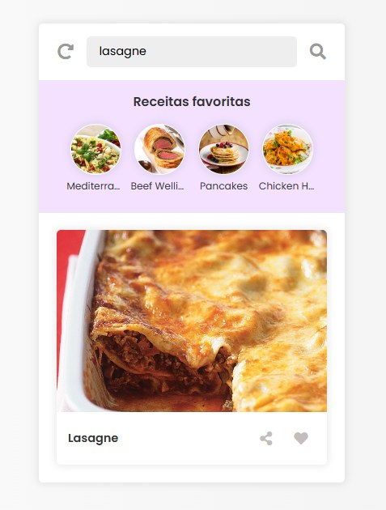

# Recipe App (jQuery)

**Demo:** https://maksoud.dev/recipe-app-jquery/



## Sobre

Projeto de estudo de jQuery feito em 2022. A cada acesso o app mostra uma receita aleatória, buscada em tempo real na API pública [TheMealDB](https://www.themealdb.com/), e permite pesquisar pratos, ver os detalhes e guardar os favoritos. Toda a página é montada pelo JavaScript com jQuery, sem frameworks e sem etapa de build.

## Funcionalidades

- Receita aleatória ao abrir a página (e botão para carregar outra)
- Pesquisa de receitas pelo nome, com mensagens de carregando, erro e "nenhuma receita encontrada"
- Popup com foto, ingredientes e modo de preparo (fecha com Esc, clique fora ou botão)
- Favoritos salvos no `localStorage`, que continuam lá depois de recarregar a página
- Botão para copiar um link que abre direto a receita (`?term=nome-da-receita`)
- Avisos rápidos ("Adicionada aos favoritos!", "Link copiado!")
- Uso pelo teclado, com foco visível, e layout que funciona no celular

## Tecnologias

- HTML5 e CSS3
- JavaScript com [jQuery 3.5.1](https://jquery.com/) (arquivo local)
- [Font Awesome 5](https://fontawesome.com/) para os ícones e a fonte Poppins (Google Fonts)
- API [TheMealDB](https://www.themealdb.com/api.php)

## Estrutura de arquivos

```
recipe-app-jquery/
├── index.html           # Página base; o conteúdo é criado pelo script.js
├── script.js            # Lógica do app: API, busca, favoritos e popup
├── style.css            # Estilos e layout responsivo
├── jquery-3.5.1.min.js  # jQuery
├── favicon.ico
└── screenshot.jpg       # Imagem usada neste README
```

## Como rodar

Basta abrir o `index.html` no navegador. Se preferir um servidor local (o botão de copiar link funciona melhor assim), rode na pasta do projeto um destes comandos:

```bash
npx serve .
# ou
python -m http.server 8000
```

e acesse o endereço mostrado no terminal (no caso do Python, http://localhost:8000).

---

Outros projetos: https://maksoud.dev/projetos/
